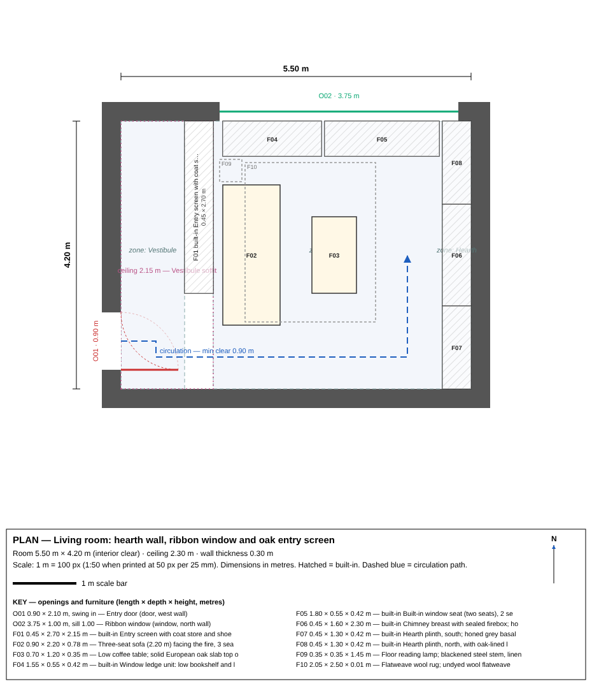
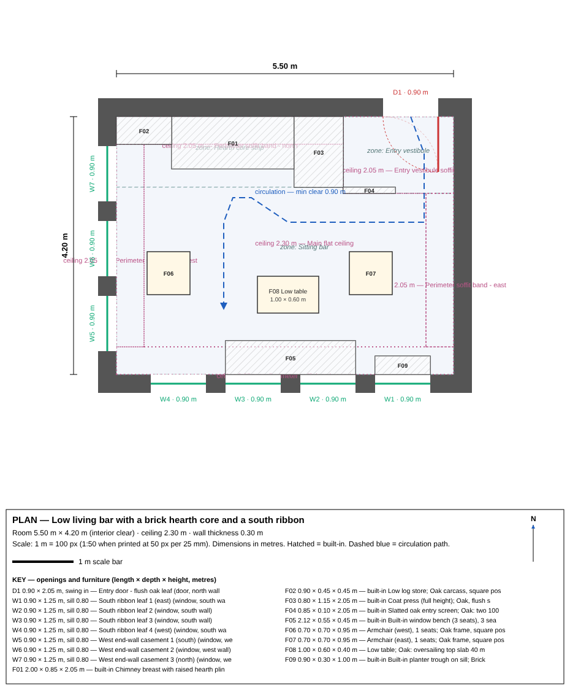

# Discussion pack — BLINK, Friday 6 November 2026, 09:30–10:00 IST

> **Read this first.** This rehearsal used archival measured drawings of one house by one architect (Library of
> Congress, HABS survey) as a stand-in corpus. It proves that the learning loop works end to end. It does **not** prove
> that a living designer's hotel interiors can be reproduced, and no BLINK data was used or invented.

## 1. Before / after summary (one page)

**Hypothesis.** Designs generated *with* explicit, example-tied rules extracted from a coherent corpus will, on held-out
briefs, (a) violate fewer stated constraints and (b) be judged more consistent with the source style than designs
generated *without* those rules, by the same model on the same briefs.

**Split.** 25 drawings → 12 learn / 6 iterate / 7 test, seeded and frozen before any drawing was opened. 5 briefs frozen
at the same time (2 practice, 3 test). Test drawings and test briefs were untouched until the final evaluation.

**What was built.** 15 rules + 6 do-nots, each citing 3–8 drawings with a quoted phrase per citation (all 81 quotes
machine-verified). Six test designs (3 briefs × 2 arms), each a dimensioned plan, principal-wall elevation, palette
board, furniture schedule and written spec.

| Measure | Baseline (brief only) | Learned (brief + rules) | Bar |
|---|---|---|---|
| Constraint violations per design (8-point checklist) | 0.0 | 0.0 | learned ≥ 2 fewer → **not met (floor effect)** |
| Blind identification, 3 supplementary Claude judges | — | 3/3 per judge, confidence 100% | ≥ 2/3 → met, **supplementary only** |
| Blind identification, human judges | — | 1 judge so far: 3/3, confidence 2–4; 1 of 3 reasons names a rule | ≥ 2/3 → **met, provisional until a 2nd judge** |
| Major decisions citing a rule | — | 46/46 (100%) | ≥ 80 % → **met** |
| Rules visible in the 7 locked drawings | — | 14/15 (1 partial contradiction) | measurement |

**Side by side (Test brief A, living room 5.5 × 4.2 m, ceiling 2.3 m):**

| Baseline | Learned |
|---|---|
|  |  |
| vestibule behind an oak screen, sofa facing a basalt-and-plaster chimney on the end wall, one 3.75 m ribbon window | brick hearth mass on the internal wall with a raised plinth and plain caps, four 0.90 m casement leaves between brick piers on the long wall plus three on the end wall, built-in window bench, sill planter, perimeter soffit band, flush entry into a vestibule |

**Honest verdict (PRD §2.4): PARTIAL PASS AT BEST — constraint criterion failed (floor effect: both arms 0 violations); human blind test not yet recorded; supplementary Claude-judge identification passes (cannot substitute for the human result).**
Learned won on traceability and on the supplementary blind identification; it could not win on constraint violations
because the baseline already made none. With one human judge recorded (3/3), the result stands at **partial pass, provisional** until a second human judge submits.

## 2. The reusable pipeline (one page)

| Step | What happens | Where it lives |
|---|---|---|
| Collect | Fetch the corpus, log source and rights per item, resize for analysis | `scripts/01_collect.py`, `data/provenance_rights.csv` |
| Freeze | Seeded split (learn / iterate / test) and briefs frozen **before** any drawing is opened | `scripts/00_freeze_splits.py`, `data/splits.json`, `briefs/` |
| Extract | One drawing per request: transcribe every legible dimension, then fill the fixed form (room, size, openings, built-ins, materials, palette, what is absent) | `prompts/transcribe_v1.txt`, `prompts/extract_v1.txt`, `scripts/02_extract.py`, `data/extractions/` |
| Aggregate | 10–15 testable rules, each citing ≥3 drawings with a quoted phrase per citation; mechanical audit of every quote | `prompts/aggregate_v1.txt`, `scripts/03_aggregate.py`, `scripts/audit_evidence.py`, `outputs/rule_library_v*.json/.md` |
| Iterate | Generate on practice briefs, compare with the practice drawings, fix rules or prompt, **freeze v2** | `outputs/iteration_log.md` |
| Generate | Same brief to two isolated designers: brief only vs brief + frozen rules; identical prompt otherwise | `prompts/generate_{baseline,learned}_v2.txt`, `scripts/04_generate.py`, `outputs/designs/` |
| Draw and check | Dimensioned plan, elevation, palette board from the spec; 8-point constraint checklist | `scripts/05_svg.py` |
| Blind test | Coin-flipped A/B, stripped diagrams, judge pack; A/B key kept apart | `scripts/06_blind.py`, `outputs/blind/` |
| Held-out check | Frozen rules checked against the locked drawings, once | `scripts/08_held_out_check.py` |
| Report | Metrics computed from the recorded files, never by hand | `scripts/07_report.py`, `outputs/metrics.md` |

To run the same loop on BLINK rooms: replace the corpus (plans, elevations, FF&E schedules, boards, photos, why-notes),
keep everything else. Every model step was run by the session model in isolated contexts; no fine-tuning, no API.

## 3. What this does and does not prove

- **Proves:** rules can be extracted from drawings with evidence that survives a mechanical audit; a frozen rulebook
  measurably changes what an otherwise identical designer produces; the loop (collect → extract → aggregate →
  iterate → generate → blind test) runs end to end with split discipline and no leakage.
- **Does not prove:** that modern hotel interiors or any living designer's work can be reproduced; that taste
  transfers from a 12-drawing archival corpus to a different building type; that judges would prefer the rule-driven
  rooms (the test asks which set *follows the rules*, not which is *better*).
- **Caveats to say out loud:** no control corpus (Corpus B was gated), so the library is untested against generic
  practice; the constraint-violation metric hit a floor (the baseline already satisfies every checkable constraint),
  so it cannot discriminate on these briefs; supplementary Claude judges are not human judges.

## 4. Talk track

- "We tested whether learned rules help. Same briefs, same model, with and without the rules. Learned won on traceability (every major decision cites an evidenced rule) and on blind identification by three independent model judges (9 of 9); it lost on the constraint count, because the baseline already made zero mistakes — that metric measures buildability, not taste. One human judge has scored 3 of 3; a second is needed before Friday for the result to count."
- "Capture first, train last. Designer data, designer judging, NDA first."
- "Pilot: one room type, one interview, sample data only, BLINK owns everything."
- "Proof before scale: blind test — clone vs generic vs past work — before scaling."

## 5. Data request for the pilot

For 20–30 hotel rooms, ideally one room type to start (e.g. standard king):

1. Sketches / concept boards for each room.
2. Plans and elevations (PDF or DWG); 3D or Revit files if they exist.
3. FF&E schedules.
4. Material boards / palettes.
5. Finished photographs.
6. **Most valuable:** short why-notes on decisions that changed — what was tried, what was rejected, and why.
7. Brand / operator standards that applied.

Sample data only until an NDA is signed. BLINK retains all ownership. Nothing leaves BLINK's control without the NDA.

## 6. What not to claim

- Do not name the proxy corpus as a hotel precedent.
- Do not claim the rehearsal used BLINK data.
- Do not promise autonomous generation without a designer in the loop.
- Do not quote a price or timeline for the full build; the pilot establishes both.
